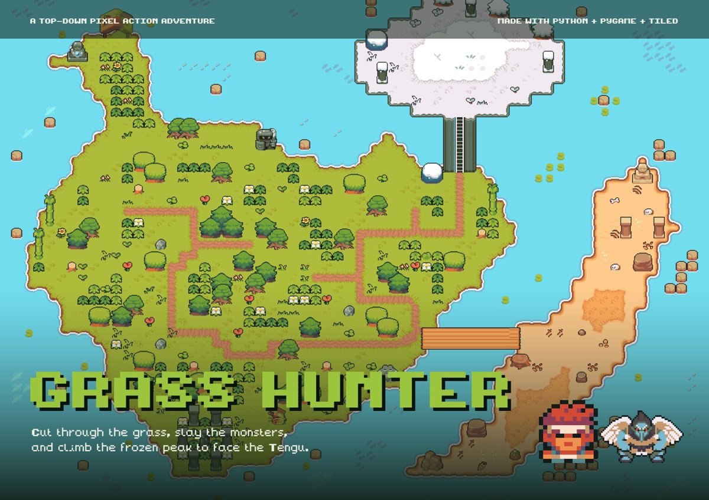

# GrassHunter

A small top-down action RPG in the style of the classic Zelda games, written in Python with pygame.
The world is designed in [Tiled](https://www.mapeditor.org/) and loaded with pytmx.



📄 **[Visual guide (PDF)](docs/grass_hunter_visual.pdf)**: world map, hero, bestiary, weapons and magic.

## Features
- Window, game loop and settings
- Player movement with collisions (smaller hitbox for realistic contacts)
- Camera that follows the player, with Y-sorting (sprites further down are drawn on top)
- World map made in Tiled: floor, details, grass, objects and invisible walls (coast, cliffs)
- Player animations: walk, idle and attack in 4 directions
- Weapons (sword, lance, axe, rapier, sai) shown in the player's hand when attacking
- UI: health and energy bars, experience, weapon and magic selection boxes
- Enemies placed in Tiled (entities layer) that notice, chase and attack the player, plus a Tengu boss
- Player / enemy interaction: weapons damage and knock back enemies, enemies damage the player,
  grass can be cut, short invincibility with flickering after a hit
- Particles: leaves flying out of cut grass, an effect on the player for each monster attack
  (slash, claw, fireball, bite, dig) and a death animation for each monster
- Magic: a heal spell and a flame spell cast in the facing direction, both costing energy
  that slowly refills
- Experience from slain monsters, spent in an upgrade menu (health, energy, attack, magic, speed)
  with a max value for each stat
- Death: a game over screen with its own music, press R to restart
- Sound: background music and effects for weapons, spells, hits, deaths and monster attacks

## Controls
| Key | Action |
|---|---|
| Arrow keys | Move |
| Space | Attack |
| Q | Switch weapon |
| E | Switch magic |
| Left Ctrl | Cast magic |
| M | Open / close the upgrade menu (arrows to choose, Space to upgrade) |
| R | Restart after a game over |

## Run it
Tested on Windows 11 with **Python 3.12 and 3.14**, pygame-ce 2.5.8 and pytmx 3.32
(exact versions in `requirements.txt`).

```bash
python -m venv .venv
.venv\Scripts\activate          # macOS / Linux: source .venv/bin/activate
pip install -r requirements.txt
python code/main.py
```
The virtual environment keeps these versions separate from other Python projects.
Do not install `pygame` and `pygame-ce` together: both provide the `pygame` module and conflict.

## Tests
The main rules (upgrades, damage, spells, combat, map data) are checked by automated tests with pytest:
```bash
pip install -r requirements-dev.txt
python -m pytest
```
They run without opening a window or playing sound.

## Project structure
```
assets/
  graphics/   sprites used by the game: player, monsters, weapons, particles, font
  audio/      music and sound effects
  tilesets/   Tiled tilesets used by the map
  actor/      original sprite sheets (Hunter character, enemies)
  animated/, vehicles/   extra Tiled tilesets from the asset pack
code/         game source (main.py is the entry point)
maps/         world_map.tmx (Tiled map read by the game)
docs/         visual guide PDF and cover image
```

## Design choices (Clean Code)
**DRY: write it once**
- `Entity` (entity.py) holds what the player and the enemies share: movement with collisions,
  animation speed and the blinking after a hit (`flicker`). Both classes inherit it.
- `sound.py` loads each sound once and shares it: the 39 enemies use the same 5 sound objects.
- particles.py loads the 6 leaf animations with one loop, and each monster's death effect
  reuses frames that are already loaded.

**SRP: one job per module and per method**
- One module per job: `level.py` runs the world, `player.py` / `enemy.py` the characters,
  `ui.py` the on-screen display, `upgrade.py` the menu, `sound.py` sounds, `support.py` images,
  `settings.py` every value that can be tuned.
- `Level.damage_player` only hurts the player; the game over sequence is in `Level.trigger_game_over`.
- Game data lives in `settings.py`: adding a monster means one entry in `monster_data`
  (stats, attack sound, death effect), with no other code to change.

## Credits
- **Graphics**: [Ninja Adventure Asset Pack](https://pixel-boy.itch.io/ninja-adventure-asset-pack)
  by **Pixel-boy** and **AAA**, released under the
  [CC0 1.0 license](https://creativecommons.org/publicdomain/zero/1.0/).
  The tilesets, the map elements and the *Hunter* character come from this pack.
  The player frames in `assets/graphics/player/` were cut from the Hunter sprite sheets
  (`Walk.png`, `Idle.png`, `Attack.png`) and scaled from 16 px to 64 px.
  The weapons in `assets/graphics/weapons/` come from the pack's `Items/Weapons` folder
  (`Sprite.png` = full, `SpriteInHand.png` = down, rotated for up/left/right), scaled to 64 px.
  The magic icons (`Ui/Skill Icon/Spell`), the magic effect frames in `assets/graphics/particles/`
  (`FX/Elemental/Flam`, `FX/Magic/Spark`, `FX/Magic/Aura`) and the UI font (`Ui/Font/NormalFont.ttf`)
  also come from the pack.
  The attack and death particles (claw, slash, sparkle, leaf_attack, thunder, squid_ink,
  raccoon_dash, spirit_explosion, and fireball / bite / dig for the monsters' attacks) were cut from
  the pack's `FX` sprite sheets, and the grass leaves
  (leaf1 to leaf6) were made from `FX/Particle/Leaf.png` and `FX/Particle/Grass.png`, all scaled ×4.
  The enemies (Snake3, Slime3, Flam, TRex, GoldRacoon, Mole, SpiderYellow) come from `Actor/Monster`
  and the boss TenguBlue from `Actor/Boss`: originals in `assets/actor/enemies/`,
  frames cut in `assets/graphics/monsters/`.
- **Music and sound effects**: also from the
  [Ninja Adventure Asset Pack](https://pixel-boy.itch.io/ninja-adventure-asset-pack) (CC0 1.0),
  stored in `assets/audio/`.
- **Code structure** inspired by the Zelda-style pygame tutorial by
  [Clear Code](https://www.youtube.com/@ClearCode).
- **Map editor**: [Tiled](https://www.mapeditor.org/), map loading with [pytmx](https://github.com/bitcraft/pytmx).
